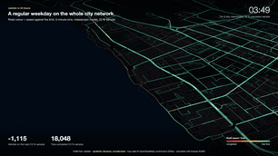
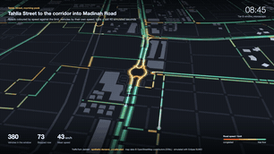
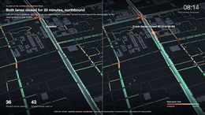
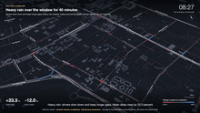
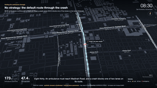
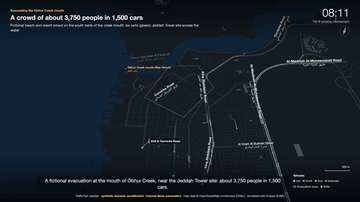
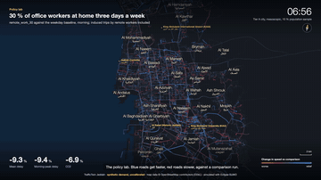
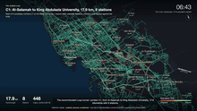

# TrafficTwin Jeddah

Open-source traffic digital twin of Jeddah: a city-wide mesoscopic model (Tier A) for policy
questions and microscopic focus windows (Tier B) for events and emergency decision support, built
on Eclipse SUMO and OpenStreetMap. See `PROJECT.md` for the brief and `docs/STATUS.md` for what is
built and measured.

> All results use **synthetic demand, uncalibrated**. Simulation and decision support only.

## Quickstart (one command)

Needs macOS (Apple silicon) or Linux with [uv](https://docs.astral.sh/uv/), Node 22+ and npm,
`make`, `curl`, and network access. `osmium-tool` is installed with Homebrew when missing (Linux:
`apt install osmium-tool`).

```bash
git clone <this repo> TrafficTwin && cd TrafficTwin
make demo            # opens http://localhost:5173 when ready; Ctrl-C stops the servers
```

`make demo` does, in order:
1. `make setup`: `uv python install 3.12`, `uv sync --frozen` (SUMO 1.28 from the `eclipse-sumo`
   wheel), `npm ci --include=dev` in `web/` (only when `package-lock.json` changed).
2. `make city-net`: downloads the Geofabrik GCC extract (243 MB, first run only), clips it to
   Jeddah and builds the v2 network `data/jeddah/jeddah.v2.net.xml` (about 2 min after the download). Skip with
   `make demo CITY=0` (no city view, no Tier A run).
3. `python -m sim.demo`: the demo runs (about 4 min; finished steps are skipped next time):
   a Tier B smoke and a fictional event scenario (accident under heavy rain, motorcade, ambulance)
   on the demo window, the emergency strategist, an evacuation, a demo-scale `remote_work_30`
   policy comparison, and a one-hour Tier A city smoke at 12:00. Run ids go to
   `runs/demo-manifest.json`.
4. `python -m api.ingest --all`, then `./run_app.sh`: API on :8000, viewer on :5173.

The viewer opens on the Tier A city run at mid-day; pick other runs in the Run panel. A
5-minute walkthrough is in `docs/demo-script.md`; the architecture in `docs/architecture.md`.

| command | what it does |
|---|---|
| `make demo` | everything above (`CITY=0` to skip the city; `DETACH=1` to leave servers in the background) |
| `./run_app.sh [--detach]` | serve whatever is in `runs/` (`TT_API_PORT`, `TT_WEB_PORT`, `TT_NO_OPEN=1`) |
| `make stop` | stop servers started with `--detach` |
| `make city` | network variant, zones and the **10 % weekday 24 h baseline** (long: about 2 h uncached, peak ~3 GB RAM; `SAMPLE=0.01` for a quick check) |
| `make test` | ruff, format check, pytest (demo window, about 3 min), web typecheck |
| `make screenshots` | headless Chrome screenshots `docs/img/final-*.png` of the running demo |
| `docker compose up --build` | the same demo in containers (a `demo` job, then `api` and `web`) |

Ports already in use? Set `TT_API_PORT=8010` (the viewer proxies to it) or stop the other server.
The Geofabrik extract is "latest", so a fresh clone builds from newer OSM data than the measured
numbers in `docs/STATUS.md` and its network hash differs; runs are deterministic for a given
network and seed.

## Setup by hand (macOS arm64 or Linux)

```bash
uv python install 3.12
uv sync                         # Python 3.12 venv; SUMO 1.28 comes from the eclipse-sumo wheel
brew install osmium-tool        # Linux: apt install osmium-tool
cd web && npm ci --include=dev  # viewer dependencies
```
SUMO binaries and tools are found through the `eclipse-sumo` wheel; `SUMO_HOME` is set
automatically by `sim/common.py` (or honoured if already set).

## Tests (demo window only, offline, about 3 min)

```bash
uv run ruff check . && uv run ruff format --check . && uv run pytest -q
```

## Build the Jeddah city network (M1, network v2)

```bash
# downloads the Geofabrik GCC extract (243 MB) on first run, clips it to data/osm/jeddah.poly,
# tags untagged major roads with the lane/speed medians measured on the clip, runs netconvert,
# applies data/osm/fixes/*.yaml and writes the GeoJSON side outputs (~2 min)
uv run python -m sim.network.build_city                        # profile v2 -> jeddah.v2.net.xml
uv run python -m sim.network.build_city --network-profile v1   # M1 settings -> jeddah.net.xml

# re-cut the committed demo window from the city network (same pipeline as Tier A)
uv run python -m sim.network.build_window --name demo --osm-extract
```
Outputs (gitignored): `data/jeddah/jeddah.v2.net.xml`, `data/jeddah/districts.geojson`,
`data/jeddah/buildings.geojson`, `data/jeddah/jeddah.v2.build.json` (provenance and network size),
`web/public/data/*.geojson` (viewer). Tier B windows (and the demo window) are cut from the v1
network. Profiles, evidence and measured effect (teleports 50.5 % -> 28.3 % in the 10 % weekday
baseline): `docs/network-v2.md`. Teleport hotspots of any run:
`uv run python -m sim.network.teleports hotspots runs/<run>/sumo.log --net data/jeddah/jeddah.v2.net.xml`.

Inspect the fix list against a built network:
```bash
uv run python -m sim.network.fixes check --net data/jeddah/jeddah.v2.net.xml
```

## Smoke runs

```bash
# Tier A: whole city, mesoscopic, one hour of random trips (run it in the background; ~9 min,
# most of it routing): prints edges, junctions, traffic lights, lane-km, vehicles, runtime,
# real-time factor and teleport share (must be < 0.5 %)
mkdir -p logs && nohup uv run python -m sim.runner --smoke --tier A --seed 1 > logs/smoke-A.log 2>&1 &
tail -f logs/smoke-A.log

# Tier B: demo window, microscopic (seconds)
uv run python -m sim.runner --smoke --tier B --seed 1
```
Each run writes `runs/<run_id>/` with `meta.json` (seed, config hash, network hash, population
hash, SUMO version, results), `stats.xml`, `tripinfo.xml`, `edgedata.xml` and `sumo.log`.

## Population and 24 h city baseline (M2)

```bash
# zones on the v2 network, then synthetic population (10 % sample), weekday activity chains, duaIterate assignment (cached by
# network/population/day type/seed), final 24 h meso run, KPIs and plots (~2 h uncached, ~15 min cached)
uv run python -m sim.population.zones
nohup uv run python -m sim.runner --baseline --daytype weekday --sample 0.10 --seed 1 --gzip > logs/baseline.log 2>&1 &
uv run python -m sim.fidelity --window demo --seed 1   # meso vs micro on a window (PROJECT.md 9.4)
```
`--routing-threads 8` speeds up assignment but makes routes reproducible from the cache only
(TA-013/TA-015). Method and measured numbers: `docs/population.md`, `docs/fidelity.md`.

## Policy lab (M4)

```bash
uv run python -m sim.runner --policy remote_work_30 --daytype weekday --sample 0.10 --seed 1
uv run python -m sim.policies.sweep --policy remote_work --param share=0.1:0.5:0.1 --sample 0.10
uv run python -m sim.validate sim/policies/*.yaml
```
Each policy run writes `runs/<policy>/policy_report.{json,md}` against the matching baseline.
Results, matched controls and noise checks: `docs/policies.md`.

## Viewer and API (M3)

```bash
uv run uvicorn api.main:app --port 8000                              # file-backed API over runs/
cd web && npm install --include=dev && npm run dev                   # http://localhost:5173
```
`./run_app.sh` starts both with the right proxy settings; `docker compose up --build` runs the
demo job and then both (API on 8000, viewer on 5173). Data contract:
`docs/contracts/run-outputs.md`; viewer guide: `docs/viewer.md`.

## Focus windows and events (M5)

```bash
# Tahlia window with service roads, Tier A exit times, cut routes + Webster signals, flow check
uv run python -m sim.link window --name tahlia
uv run python -m sim.link tier-a --routes runs/source-smoke-A/routes.rou.xml --seed 1
uv run python -m sim.link cut --window tahlia --tier-a runs/tierA-exit-<hash>/
uv run python -m sim.link check --window tahlia --tier-a runs/tierA-exit-<hash>/ --seed 1
# a scenario against the window baseline (same seed): runs/<id>/scenario_report.{json,md}
uv run python -m sim.runner --scenario accident_tahlia --window tahlia --seed 1
```
Create the source route set first: `uv run python -m sim.runner --smoke --tier A --seed 1`, then
`mkdir -p runs/source-smoke-A && cp runs/smoke-A-s1-*/routes.rou.xml runs/source-smoke-A/`. Demo
scenarios: `sim/scenarios/{accident,rain,flood,motorcade,emergency}_tahlia.yaml` (fictional).
Results and caveats: `docs/events.md`.

## Emergency strategist (M6)

```bash
uv run python -m strategist.run --scenario emergency_tahlia_0830 --window tahlia --seed 1
uv run python -m strategist.approve <recommendation_id> [--option 1] [--actor name] [--reject]
uv run python -m strategist.log verify      # hash-chained, append-only decision log
```
Pipeline, actions and measured runs: `docs/strategist.md`.

## Evacuation (M7)

```bash
uv run python -m sim.runner --scenario evac_demo --seed 1             # demo window, ~15 s
uv run python -m sim.runner --scenario evac_corniche_hamra --seed 1   # Al Hamra (tahlia window)
uv run python -m strategist.evacuation run --scenario evac_corniche_hamra --seed 1
```
`sim.runner --scenario evac_*` dispatches to `sim.events.evacuation run`. Method and results:
`docs/evacuation.md`.

## Loop tunnels (Track D)

```bash
uv run python -m sim.loop.run loop_demo --demo          # demo policy on the demo window, ~10 s
uv run python -m sim.loop.site                          # candidate corridors + map
uv run python -m sim.loop.run loop_recommended          # recommended corridor C1, city 10 %, ~10 min
```
Siting, candidate ranking, the policy sweep and the recommendation (C1 Al-Salamah - King Abdulaziz
University, shuttle mode capped at measured capacity): `docs/loop.md`.

## Calibration (M8, dormant until counts exist)

```bash
uv run python -m sim.adapters.synthetic --net data/demo/demo.net.xml --out runs/synthetic-demo --seed 1
uv run python -m sim.calibrate --counts runs/synthetic-demo/counts.csv --net data/demo/demo.net.xml \
  --routes runs/synthetic-demo/candidates.rou.xml --sample 1.0 \
  --travel-times runs/synthetic-demo/traveltimes.csv --counts-source synthetic --before
```
Synthetic counts only exercise the pipeline. See `docs/calibration.md`.

## Movies

Short films rendered from the runs (edge bins, trajectories, event and strategist outputs), one
per simulation mode, plus a showreel. Needs ffmpeg and Google Chrome; output in `movies/`.

```bash
make movies                         # all films + movies/showreel.mp4
make movie FILM=tahlia-street       # one film; MOVIE_FLAGS="--4k --fps 60 --letterbox" optional
```

| | |
|---|---|
|  |  |
| `city-24h`: the weekday baseline as a 24 h time-lapse | `tahlia-street`: street level, morning peak |
|  |  |
| `incident`: crash run against its baseline | `events`: rain, flood, motorcade |
|  |  |
| `strategist`: the top 3 ambulance options | `evacuation`: phased release with contraflow |
|  |  |
| `policy-lab`: policies in difference mode | `loop`: the recommended Loop tunnel C1 against the baseline |

How it works, the spec schema and the camera-path cookbook: `docs/movies.md`.

## Lane audit from imagery (blocked)

`sim/network/lane_audit.py` is built but its calibration precision is below the gate, so no
imagery-derived lanes are applied; the default network is v2 (OSM-measured defaults, `docs/network-v2.md`).
See `docs/lane-audit.md`.

## Layout

`sim/` simulation (network, population, day types, policies, events, runner), `strategist/`
decision logic, `api/` + `web/` presentation, `docs/` status, assumptions and data sources,
`tests/` demo-window tests.

## Licence

Code: Apache-2.0 (`LICENSE`). Data derived from OpenStreetMap is (c) OpenStreetMap contributors,
ODbL; SUMO is EPL-2.0 (dependency, not vendored); GASTAT open data with attribution. See `NOTICE`.

Contributing: `CONTRIBUTING.md`. Changes: `CHANGELOG.md`.
