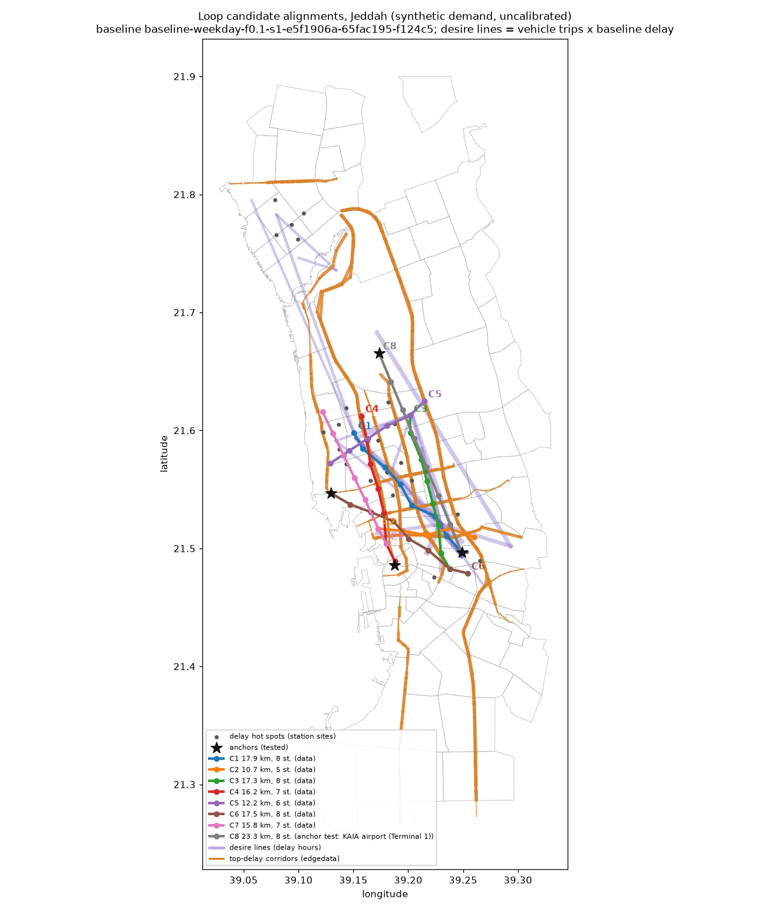

# Jeddah Loop tunnels: siting and optimal policy (Track D)

> **Synthetic demand, uncalibrated.** Every number on this page comes from a synthetic population
> on an uncalibrated Tier A (mesoscopic) model of Jeddah, 10 % weekday sample, seed 1. The
> baseline is gridlock-affected in both peaks (TA-011, 0.51 teleports per vehicle). Read the
> results as a comparison of corridors and policies under stated assumptions, not as a forecast.

## Question

Boring Company style "Loop" systems are small-bore (3.6 m) twin tunnels with surface stations and
station-to-station electric vehicles (Las Vegas: Tesla Model Y driven by staff; Dubai: RTA
contract, Feb 2026, 6.4 km pilot and 22.2 km full system). Which Jeddah corridors would relieve the
most congestion, and which way of running them (shuttle service or private-EV toll tunnel, speed,
toll) gives the most relief per riyal?

## Commands

```
uv run python -m sim.loop.site                                   # candidates + map (seconds)
uv run python -m sim.loop.evaluate --candidates sim/loop/candidates.yaml   # one city run each
uv run python -m sim.loop.evaluate --sim-seed 2                  # seed-2 replicates
uv run python -m sim.loop.optimise                               # greedy + sweep, fills this page
uv run python -m sim.loop.run loop_demo --demo                   # demo policy, demo window, ~10 s
uv run python -m sim.loop.run loop_recommended                   # recommended policy, city 10 %
```

Runs go to `runs/<policy id>/` (`loop_report.md`, Track A's `policy_report.md`). Machine-readable
results: `sim/loop/candidates.yaml`, `sim/loop/results/*.json|csv`.

## Model

**Tunnel network** (`sim/loop/network.py`). For an alignment (ordered stations), one tunnel node
under each station, one single-lane tunnel edge per direction between consecutive stations
(length = crow distance x 1.15), and a down ramp and an up ramp (150 m, 40 km/h) per station to
the nearest non-signalised junction with main-road edges in the network's main strongly connected
component. Intermediate stations are bypassed by through vehicles (express service). The network is
written under a new name (`data/jeddah/jeddah.loop-<key>.net.xml.gz`); the base network is not
touched. Shuttle mode admits only the shuttle class (SUMO `custom1`); private-EV mode admits
passenger cars and connects the surface approaches to the down ramps.

**Capacity.** SUMO meso has no per-vehicle headway, so tunnel and ramp edges carry a meso edge type
with their own headway, scaled by 1/sample like every other headway (A-sim-101). Two scenarios:
*measured*, 1,355 passengers/h per station pair (Las Vegas, July 2021), i.e. one shuttle every
5.3 s at 2 passengers; *engineering*, one vehicle every 1.5 s (brief range 1-2 s), i.e. 4,800
passengers/h per direction at 2 passengers (vendor side, not demonstrated).

**Shuttle mode** (`loop_shuttle`). A car-driver or ride-hail tour shifts if every leg runs between
two different stations of one line (origin within R_o, destination within R_d, at least 2 km
apart); a share alpha of those tours shifts (hashed draw per tour, so alpha sweeps are nested).
Their car trips are removed; passengers reach the station after a walk and fill shuttles of 2 in
arrival order per station pair (a shuttle leaves with its last passenger, 30 s loading stop), plus
0.3 empty repositioning trips per loaded trip. Passengers are not simulated as persons: their
door-to-door time is estimated after the run (walk, wait, simulated shuttle trip) and compared
with the same leg by car in the baseline. Quality flags: share of shifted passengers above the
station-pair capacity in their hour; tunnel segment utilisation; share of riders slower than by
car.

**Private-EV mode** (`loop_private`). The tunnels are open to passenger cars; the toll per entry
becomes a routing penalty (toll / value of time, SAR 40/h) on the down ramps. Every car whose ends
lie within 2.5 km of two different stations gets a one-shot route on the baseline's congested
travel times (Track A's incremental routing, TA-014) and uses the tunnel only if it is faster
including the toll. Because this re-routes baseline vehicles, each run comes with Track A's
matched control (TA-018): the same cars re-routed on the base network without the tunnel. The
headway limit applies in the simulation; one-shot routing does not see it, so a popular free
tunnel queues at its portals.

**Siting** (`sim/loop/site.py`). Desire lines are district-to-district vehicle trips x baseline
delay per trip; top corridors are street names ranked by the day's time loss. Station sites are
delay-weighted trip-end hot spots (750 m grid, at least 1.5 km apart); every pair of sites 6-25
tunnel-km apart becomes a straight alignment with 4-8 stations at 1.5-3 km, intermediate stations
snapped to the best site within 700 m, scored by the baseline delay of trips both of whose ends
fall within 1.5 km of two different stations. Eight candidates are chosen by captured delay per
tunnel-km with an overlap rule. KAIA airport, Al Balad/Corniche, Tahlia/Al Andalus and KAU are
added as sites without any bonus: an anchor not covered by a data-driven pick gets its best
alignment as an explicit test candidate.

**Objective: congestion relief.** City VHT falls simply because shifted cars disappear; counting
their hours as "saved" would reward removing trips, not relieving traffic. The decision metric is
therefore *congestion relief*: the hours (travel time plus departure delay) saved by the vehicles
that are on the road in both runs (same vehicle, shuttles excluded), per USD M of capex. Riders'
extra door-to-door time against their own baseline car trip is reported as net person-hours
(relief minus riders' extra time). City VHT saved is shown for reference.

**Evaluation and optimisation.** Each candidate is one city policy run (shuttle, alpha 0.5,
90 km/h, measured capacity) against the baseline, and again with simulation seed 2 against the
seed-2 baseline replicate (Track A's replicate machinery): single runs near gridlock are noisy
(a sim-seed change alone moves city VHT by about 1 %). Candidates are ranked on the two-seed mean
relief per tunnel-km. The greedy step takes them in that order within the 25 km budget, skipping
overlaps and any candidate whose two seeds disagree in sign or whose mean is inside the two-seed
noise; if one corridor alone relieves more than the whole per-km greedy set (the budget left
after the first pick may fit nothing), it is taken instead (standard knapsack correction). The
selected set is run together. The sweep varies the levers (mode, tunnel speed, toll) and,
separately, the uncertainties (alpha, access radius, capacity, and a time-competitive shift in
which only legs faster by Loop than by car may shift, under measured and vendor speeds and
waits). The recommendation is the lever setting with the most relief per USD M at central
assumptions that passes the quality gate (pair and tunnel-segment capacity exceedance at most
10 %, teleports not worse than the comparison beyond the replicate's change, positive relief).

## Candidate corridors



<!-- LOOP:candidates -->
<!-- /LOOP:candidates -->

## Ranking (one city run per candidate)

Shuttle mode, alpha 0.5, 90 km/h, measured capacity, 10 % sample. Relief, VHT and passengers are
city-equivalent per weekday. "Relief seed 1" is against the baseline, "seed 2" against the seed-2
baseline replicate; ranking is on the mean per tunnel-km. Capex at USD 15 / 25 / 40 M per km; the
per-USD-M range runs from high to low capex. Flags are from the seed-1 run.

<!-- LOOP:ranking -->
<!-- /LOOP:ranking -->

## Greedy selection under the 25 km budget

<!-- LOOP:greedy -->
<!-- /LOOP:greedy -->

## Sweep on the selected corridors

<!-- LOOP:sweep -->
<!-- /LOOP:sweep -->

## Recommendation

<!-- LOOP:recommendation -->
<!-- /LOOP:recommendation -->

## Noise and checks

<!-- LOOP:noise -->
<!-- /LOOP:noise -->

## Vendor claims versus measured figures

FINDINGS_VENDOR

## Findings

FINDINGS

## Caveats

- **Synthetic, uncalibrated, gridlock-affected baseline.** Meso delay is strongly non-linear near
  gridlock (Track A: removing ~2 % of trips can cut mean delay by ~10 %); VHT savings here are
  larger than a calibrated, less congested network would show. Rankings between corridors are more
  robust than the absolute savings.
- **Exogenous shift share.** alpha is assumed, not modelled; the rider-time flag shows how many
  shifted legs would be slower by Loop than by car. A real system would attract fewer of those.
- **No induced demand, no re-equilibration.** Freed road space is not refilled by new or re-routed
  trips (one-shot routing, A-pol-090), which flatters every option equally.
- **Passengers are not simulated.** Walk, wait and transfers are estimated; there are no transfers
  between lines and no station dwell queues beyond the loading stop and the tunnel headway.
- **Private mode routing** is one-shot on baseline travel times and does not anticipate the
  tunnel's own queue; the matched control removes the generic routing gain (TA-018).
- **Costs** are per alignment-km from three projects with different scopes (LVCC, Music City,
  Dubai); no Saudi ground conditions, utilities or land costs. No operating cost or fare revenue in
  the per-USD-M metric (toll revenue is reported for private mode).
- **Weekday only**; Friday, Ramadan and event days are not evaluated.
- **One seed** for most runs; the noise band comes from one replicate.

Assumptions: `docs/assumptions-trackD.md` (A-loop-001..016). Sources:
`docs/data-sources-trackD.md`. Decisions: `docs/status/trackD.md` (TD-001..).
